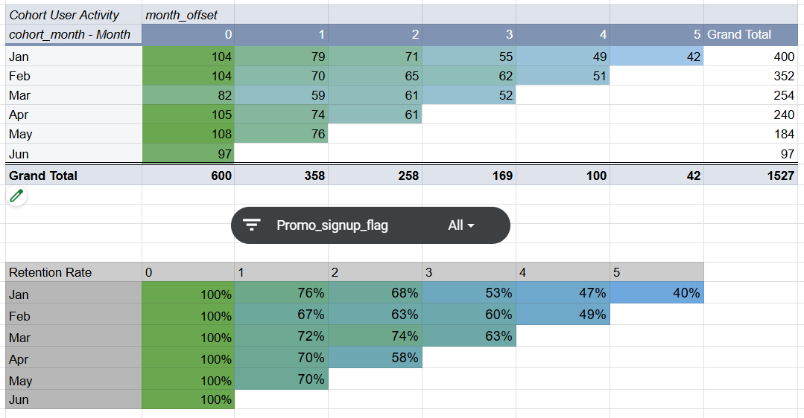

# Cohort & Retention Analysis

## Project Overview
This project analyzes user retention using cohort analysis. The goal is to understand how user engagement changes over time and compare retention patterns between promotional and organic users.

## Business Problem
Understanding user retention helps businesses evaluate user engagement, identify retention trends, and assess the effectiveness of promotional acquisition strategies.

## Objectives
- Analyze user retention across monthly cohorts.
- Calculate retention rates for subsequent months.
- Compare promotional and organic users.
- Identify retention patterns and potential areas for improvement.
- Provide data-driven business recommendations.

## Tools & Technologies
- SQL
- PostgreSQL
- Google Sheets
- Cohort Analysis
- Data Visualization

## Methodology
1. Prepared and validated user registration and activity data.
2. Defined monthly cohorts based on registration dates.
3. Calculated monthly retention rates.
4. Compared retention between promotional and organic users.
5. Visualized results using cohort tables and conditional formatting.
6. Developed business insights and recommendations.

## Key Findings
  Declining User Activity: Cohort analysis shows a gradual decline in user activity over the months following registration. User activity is highest during the registration month, after which some users stop engaging with the product.
  Promotional vs. Organic Acquisition: The promo_signup_flag filter enables a comparison of retention patterns between users acquired through promotional campaigns and those acquired organically.
  Long-Term Retention: Promotional campaigns may generate a higher initial influx of users, while organically acquired users may demonstrate more stable long-term retention. This pattern should be validated against the actual cohort retention metrics.
  
## Business Recommendations
  Evaluate Promotional Campaign Effectiveness. Compare not only the number of acquired users but also their long-term retention and engagement to assess the value of promotional campaigns.
  Investigate Promotional User Churn. Examine whether the product meets the expectations of users acquired through discounts, promotions, and promo codes. Identify potential reasons for declining engagement.
  Identify Successful Organic Retention Practices. Analyze organic acquisition sources and the behavior of users with higher retention rates to identify opportunities to improve user acquisition and long-term engagement.

## Project Deliverables
- SQL queries used for data preparation and analysis.
- Cohort retention tables.
- Promotional vs. organic user comparison.
- Data visualizations and business insights.

## Author
Valerii Roznalievich
Aspiring Data Analyst | SQL • PostgreSQL • Google Sheets
LinkedIn www.linkedin.com/in/valerii-roznalievich-data

## Project Screenshots

### Cohort Analysis Overview

### Promotional Users

### Organic Users

